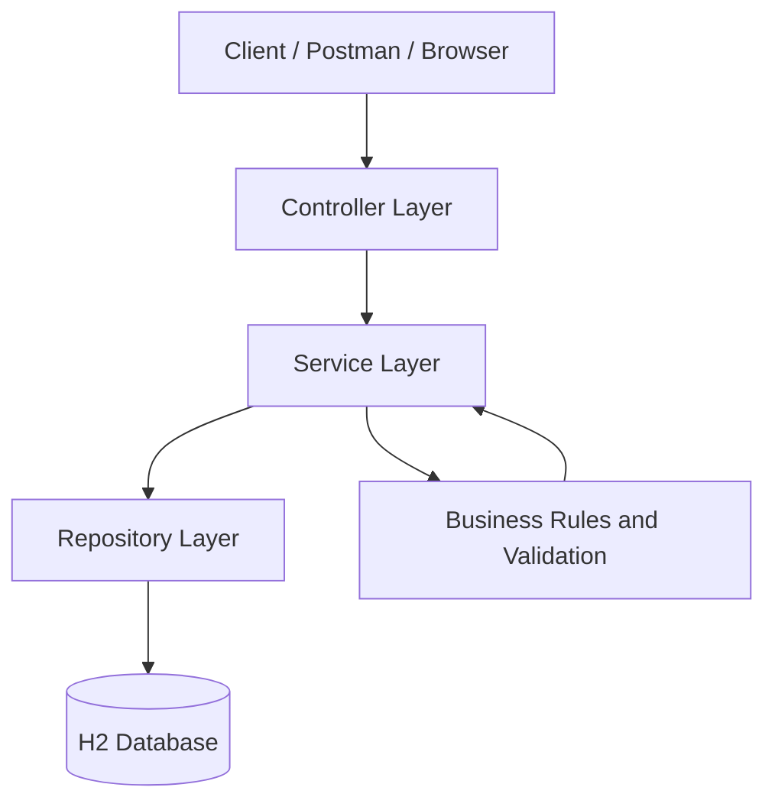

# Architecture and Request Flow

## Layers
- **Presentation:** `BookController`, `MemberController`, `LoanController` receive HTTP requests and return JSON.
- **Business:** `BookService`, `MemberService`, `LoanService` enforce application rules.
- **Data access:** `BookRepository`, `MemberRepository`, `LoanRepository` use Spring Data JPA.
- **Data:** H2 in-memory database stores books, members, and loans.

## Domain relationships
- A `Book` can appear in many `Loan` records over time.
- A `Member` can have many `Loan` records over time.
- Every `Loan` points to one `Book` and one `Member`.
